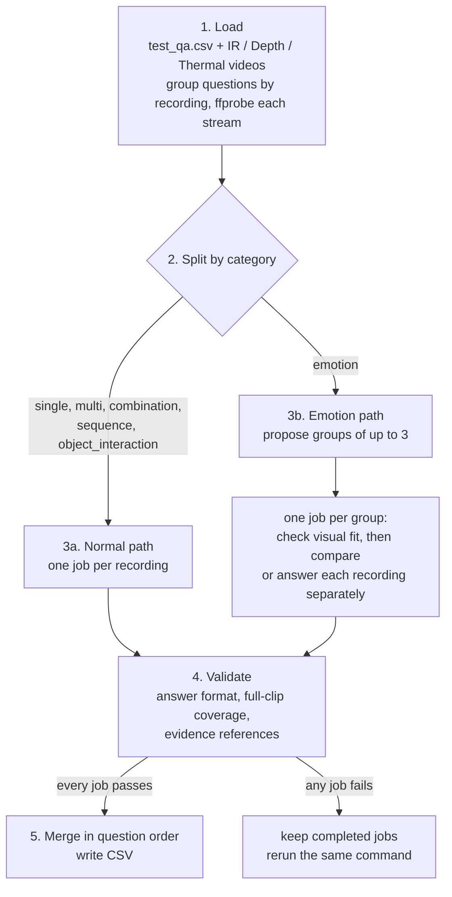

# Let the Model Choose Where to Look

**CUHK-X Challenge 2026 · Large Model Track · 3rd place solution**

Team azamat1ch

## Summary

The Large Model Track asks multiple-choice questions about human activity in
non-RGB video (IR, Depth, Thermal): which actions happen, which object is
handled, in what order, and in what manner. Our view is that deciding where to
look is part of video reasoning. So we do not feed the model a fixed set of
frames. A GPT-6 Astra agent (OpenAI Agents SDK) inspects each recording through
tools. It starts with a sparse overview, then asks for dense, cropped, zoomed or
enhanced views of the moments that decide between options. It reads written
guidance notes ("skills") when it needs them. It answers all of a recording's
questions together and cites the frames it saw as evidence. Manner ("emotion")
questions are answered for groups of up to three related recordings, after a
visual check that they show the same routine. No model is trained or fine-tuned.

## Result

3rd place, Large Model Track, CUHK-X Challenge 2026 Grand Finals (UbiComp/ISWC 2026, Shanghai)

## How it works

A *job* is one agent conversation: one recording on the normal path, or one
emotion group on the emotion path.



- **1. Load.** Group questions by recording. `ffprobe` gives each video's
  duration, frame rate and resolution; `hashlib` its SHA-256.
- **2. Split.** Emotion questions go to the emotion path, all others to normal.
- **3a. Normal path.** The agent overviews the recording end to end, then looks
  closer where options differ. It returns cited answers and an event timeline.
- **3b. Emotion path.** The agent first checks whether the group's recordings
  show the same person, setting and routine. Only then does it compare pace and
  handling across them. If they do not fit, it answers each recording on its own.
- **4. Validate.** A failed check (see Validation) fails the job.
- **5. Merge.** The CSV is written only when every job passes.

### Agent tools

| Tool | What it does |
| --- | --- |
| `list_skills` | Returns the index of skills and their reference files. |
| `read_skill(skill_id, resource=None)` | Returns one skill, or one of its listed reference files. |
| `describe_recording(recording_id="r1")` | Lists available streams with duration, frame rate and resolution. No file paths. |
| `view_recording(...)` | Returns real decoded frames from one stream. Each frame carries a reference ID the agent must cite. |

`view_recording` parameters:

| Parameter | Meaning |
| --- | --- |
| `source` | `IR`, `Depth` or `Thermal` |
| `start_s`, `end_s` | Time range in seconds from the stream's first frame; omit for the full clip |
| `fps`, `timestamps_s` | Sampling rate (default `0.25`; `null` returns every native frame), or an explicit list of times |
| `crop`, `zoom` | `[left, top, right, bottom]` in original pixels; `1`–`8` bicubic enlargement |
| `gamma`, `contrast`, `sharpen` | `0.1`–`5` (above 1 brightens); `none`, `stretch` or `clahe`; `0`–`2` |
| `rotation` | `0`, `90`, `180` or `270` degrees clockwise |
| `layout` | `sheets` (timestamped contact sheets), `individual`, or `detail` (needs a crop; adds one full context frame per page) |
| `page`, `page_size` | Paging; default 24 frames per page |
| `recording_id` | Group member `r1`–`r3` (emotion jobs) |

Invalid parameters come back as correctable errors. Frames are decoded on the
CPU with FFmpeg and cached. Streams are not assumed to be time-aligned.

### Skills

| Skill | Used by | What it covers |
| --- | --- | --- |
| `visual-inspection` | all jobs | Covering a recording end to end; when to densify, crop, enhance or zoom; separate source clocks. |
| `action-cues` | all jobs | Physical cues for the 44 actions, in five references: body movement, desk and devices, food and drink, household, personal care. |
| `objects` | normal | Identifying the handled object, plus the dataset's object-naming conventions from training labels (133 training object questions). |
| `question-reasoning` | normal | What each question category asks for; repeated, overlapping and combined actions; ordering. |
| `emotion-comparison` | emotion | Comparing manner across related recordings: matched pace, how shared options pair up, close word distinctions. |

### How emotion groups are proposed

Grouping uses only the test inputs (folder names, questions, options). See
`src/cuhk/emotion.py`.

1. If every recording with emotion questions is named `LM_test_<n>` with a
   unique number, link recordings whose numbers are adjacent and that share at
   least 3 normalised emotion options.
2. Otherwise, link recordings with identical question structure, at least 3
   shared emotion options, and at least 2 shared sequence options or a shared
   combination bundle.
3. Linked sets of up to 3 become groups. Larger sets become singletons.
4. With numbering, leftover recordings with consecutive numbers and matching
   question structure may join each other or an adjacent pair, forming an
   "uncertain" group of up to 3.
5. Each group carries a `candidate_basis` label. The agent then decides
   `compatible`, `incompatible`, `uncertain` or `singleton`, with a reason.

### Validation

A job passes only if:

- Every question is answered once in the allowed format: a permutation for
  sequence questions, a subset for multi-answer questions, one letter otherwise.
- Each recording has a full-clip overview (every page) of at least one stream
  whose duration is within 1 s of the longest stream's.
- Every timeline event has a valid source and time bounds, a visible feature,
  and references to delivered frames from the same source that overlap it.
- Emotion jobs include a group assessment with reason, comparisons and the
  strongest alternative.

If only the evidence references are wrong, the agent gets one correction pass
without tools that must keep every answer unchanged.

## Quick start

### Requirements

- Linux (x86_64), Python 3.12, FFmpeg and `ffprobe` on `PATH`
- OpenAI API access to `gpt-6-astra`
- No GPU. CPU for decoding, plus disk space for frames and run traces.

| Variable | Required | Meaning |
| --- | --- | --- |
| `OPENAI_API_KEY` | Yes | API key. Can also be a plain `OPENAI_API_KEY=...` line (no `export`) in a `.env` file in the working directory. |
| `OPENAI_BASE_URL` | No | API endpoint. Default `https://api.openai.com/v1`. Must be HTTPS (HTTP only on loopback), with no credentials, query or fragment. |

### Docker

```bash
docker build -f environment/Dockerfile -t cuhk-x-large .

docker run --rm --user "$(id -u):$(id -g)" -e OPENAI_API_KEY \
  -v /path/to/data:/data:ro \
  -v /path/to/out:/out \
  cuhk-x-large bash inference.sh /data /out/predictions.csv
```

`--user` keeps the output owned by you; add `-e OPENAI_BASE_URL` for another endpoint.

### Local

Run from the repository root (`.env` is read from the working directory).

```bash
python3.12 -m venv .venv
. .venv/bin/activate
pip install -r environment/requirements.txt

export OPENAI_API_KEY=...
bash inference.sh /path/to/data /path/to/out/predictions.csv
```

Add `--validate-only` for a dry run without model calls or an API key. It
checks the inputs, probes the videos, proposes emotion groups and prints counts.
The `output_csv` argument is still required but not checked. (`--help` prints
usage as `portable.py`, the module `inference.sh` runs.)

### Input and output

```
<data_dir>/
├── test_qa.csv                                  # exactly one in the tree
└── large_model_track_test/<recording>/{IR,Depth,Thermal}/*.mp4
```

- `test_qa.csv` columns: `qa_id, source, path, category, question, A, B, C, D`.
- Videos are found recursively and matched to recordings by the `path`
  column. The parent folder name (`IR`, `Depth`, `Thermal`) gives the stream.
- `path` values and video paths must contain `large_model_track_test/<recording>`.
  Recording folders named `LM_test_<n>` enable numbered emotion grouping.
  Symlinked recording folders are not followed.
- The output is a CSV with header `qa_id,prediction`, rows in input question
  order, written atomically. Its path must not exist yet and must be outside
  the input directory.

## Configuration

`configs/final.toml`:

| Key | Value | Meaning |
| --- | --- | --- |
| `model` | `gpt-6-astra` | Model name |
| `reasoning` | `xhigh` | Reasoning effort |
| `workers`, `preparation_workers` | `3`, `2` | Jobs run in parallel; parallel video decoding tasks |
| `normal_timeout_s`, `emotion_timeout_s` | `900`, `1200` | Whole-job time limit, including decoding |

`model` must be exactly `gpt-6-astra`, and a job fails if the API reports a
model name that does not start with it. An optional `base_url` key overrides
`OPENAI_BASE_URL`; it is not set. Fixed in code: Responses API with
`store=False`, parallel tool calls, tracing off, no turn limit.

Retries (at most 5, backoff capped at 32 s) cover HTTP 429 `rate_limit_exceeded`
(waiting at least `Retry-After`, giving up above 60 s), one specific HTTP 500
reporting a failed upstream connection, and failures to open the connection
(connect errors or timeouts). Read timeouts and dropped connections are not retried.

## Run artefacts and resuming

The runner keeps everything for a run next to the output, in `<output>.work/`:

```
predictions.csv.work/
├── lock                 # one run at a time
├── identity.json        # run identity (see Safety below)
├── views/               # shared cache of decoded frames
├── normal/<job-id>/     # completed.json (passing result) + attempt-NNN/
└── emotion/<group-id>/  # same layout
```

Each `attempt-NNN/` holds that attempt's files, e.g. `input.json`,
`model-calls.json`, `history.json`, `result.json`, `receipt.json`.

- **Resume:** if any job fails, completed jobs are kept. Rerun the same command
  to retry only the unfinished jobs.
- **Safety:** a resume is refused if the config, endpoint, prompts, source code,
  questions or video files changed, or if the data directory moved (absolute
  video paths are part of the run identity). Choose a new output path then.

## Development notes

All numbers below were measured on training recordings against the official
training labels, using earlier pipeline variants or standalone classifiers.

| Experiment | Result | Decision |
| --- | --- | --- |
| Base model: GPT-6 Astra vs an alternative hosted model | 364 vs 333 of 430 answers (41 fixes, 10 regressions) | Use Astra |
| Report-based pipeline (text report per stream and window, then answer) | Reports lost brief hand and object detail | Replaced by the agent looking at frames |
| Duration-based frame sampling vs dense sampling | 343 vs 346 of 430, with 76% fewer frames (25 fixes, 28 regressions) | No fixed budget; agent chooses where to look |
| Adding Depth to IR with three-draw voting | 55/69 with and without Depth | Depth is an optional view |
| IMU feature-based single-action classifiers | Best 146/442 top-1 (33%) | IMU not used |
| IR video classifiers | R3D-18 23/122, ResNet 20/122 top-1 | Not used |
| Labelled example frames from other people in the prompt | Changed no answers | Not used |
| Skills | Added one by one wherever development errors showed a recurring confusion | Kept |

## Limitations

- **Cost and one closed model.** About USD 300–500 per full test-set run via
  the direct API (team estimate, not a measurement); needs `gpt-6-astra`.
- **Nondeterminism.** The hosted model is not deterministic, so reruns can
  change some answers.
- **Emotion grouping relies on metadata.** Numbered grouping only recognises
  `LM_test_<n>` folders; without it or shared options, more recordings become
  singletons.
- **Naming conventions.** The `objects` skill assumes test labels follow the
  training naming conventions.
- **Strict checks.** A missing full-clip overview fails the job. Timeouts and
  errors that are not retried need a rerun.
- **Known hard cases.** Manner questions with weak acting; very short hand
  actions between overview samples; close object classes (phone, smartphone,
  remote) when the hand hides the object.

## Repository layout

```
inference.sh            entry point (runs src/cuhk/portable.py)
configs/final.toml      model and run settings
environment/            Dockerfile, pinned requirements.txt
prompts/investigators/  job instructions (normal.md, emotion.md) and skills/
src/cuhk/               portable.py runs the pipeline; investigator.py holds the agent,
                        tools and validation; inspection.py renders frames;
                        emotion.py proposes groups; transport_retry.py sets retries
```

## Changes from the evaluated archive

The code, prompts and config are the archive the organisers evaluated, with
these small cleanups. None changes the pipeline logic. The default endpoint is
the only behavioural change; the only model-visible text change is the source
line in `training-distribution.md`.

- `src/cuhk/providers.py`: default endpoint is now `https://api.openai.com/v1` (was a loopback address); only `OPENAI_API_KEY` is read (a second, loopback-only key variable was removed). URL safety checks are unchanged.
- `src/cuhk/transport_retry.py`: a comment now uses neutral wording, and one retry reason label was renamed to `upstream_not_connected`. Retry logic is unchanged.
- `configs/final.toml`: removed one comment about the endpoint fallback. All values are unchanged.
- `prompts/investigators/skills/objects/references/training-distribution.md`: removed an internal document path and date from the source line. The table and notes are unchanged.

All other files in `src/`, `prompts/` and `configs/`, plus `inference.sh`,
`environment/Dockerfile` and `environment/requirements.txt`, are byte-identical
to the archive. `README.md`, `LICENSE`, `NOTICE`, `.gitignore` and
`.dockerignore` are new.

## Data and licence

- No dataset files are included. Get the data from the organisers.
- Code is under the Apache License 2.0 (see `LICENSE`).
- Some skills contain content derived from the CUHK-X dataset. That content
  is under CC BY-NC 4.0, not the Apache License 2.0. See `NOTICE`.

## Citation

If you use this code, please cite the CUHK-X dataset:

```bibtex
@inproceedings{jiang2026cuhkx,
  title     = {A Large-Scale Multimodal Dataset and Benchmarks for Human Activity Scene Understanding and Reasoning},
  author    = {Jiang, Siyang and Yuan, Mu and Ji, Xiang and Yang, Bufang and Liu, Zeyu and Xu, Lilin and Li, Yang and He, Yuting and Dong, Liran and Lu, Wenrui and Yan, Zhenyu and Jiang, Xiaofan and Gao, Wei and Chen, Hongkai and Xing, Guoliang},
  booktitle = {Proceedings of the 24th Annual International Conference on Mobile Systems, Applications and Services (MobiSys '26)},
  year      = {2026}
}
```

We thank the CUHK AIoT Lab for the CUHK-X dataset and the challenge.
